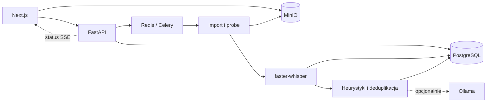

# Astoka

Self-hosted prototyp narzędzia Akademii 100k do wybierania fragmentów z długich nagrań. Obecny kod obejmuje projekty, import materiału, transkrypcję i propozycje highlightów. Docelowo projekt ma wspierać produkcję pionowych shortów z polskimi napisami.

**Status: MVP w rozwoju. Eksport gotowego MP4, kadrowanie 9:16 i wypalanie napisów nie są jeszcze zaimplementowane.** Akceptacja highlightu zapisuje jego status; nie uruchamia renderowania.

Dokumenty projektowe: [PRD](PRD-Astoka.md) i [research detekcji highlightów](RESEARCH-Highlight-Detection.md). Opisują również wymagania i plany wykraczające poza bieżącą implementację.

## Zakres obecnego kodu

| Obszar | Implementacja |
|---|---|
| Dostęp i projekty | Logowanie kontem demonstracyjnym, tworzenie i wyświetlanie projektów, archiwizacja i przywracanie |
| Import | Upload przez podpisany URL MinIO lub pobranie z YouTube przez yt-dlp |
| Analiza pliku | Metadane ffprobe, hash treści i podgląd wideo 480p |
| Transkrypcja | faster-whisper, timestampy słów, zapis segmentów i ponowne użycie transkrypcji na podstawie hasha |
| Highlighty | Kandydaci oceniani heurystycznie, opcjonalny ranking przez Ollama, deduplikacja i korekta granic fragmentów |
| Interfejs | Status zadań przez SSE, widok transkrypcji z czasami segmentów, akceptacja i odrzucanie propozycji |
| Do realizacji | Render shortów, reframe 9:16, napisy ASS/burn-in, edycja transkrypcji i usuwanie wypełniaczy, pełna administracja użytkownikami |

Ocena highlightu jest wynikiem algorytmu lub modelu, a nie pomiarem zasięgu publikacji. Raport [ASR baseline](docs/asr-baseline.md) ma status `PENDING`: cele jakości i szybkości z PRD nie są potwierdzonymi benchmarkami.

## Stos i przepływ danych

| Warstwa | Technologie |
|---|---|
| Web | Next.js 14 App Router, React 18, TypeScript, Tailwind CSS, komponenty oparte na Radix/shadcn |
| API | FastAPI, Pydantic 2, SQLAlchemy 2, Alembic, JWT i cookie |
| Zadania | Celery 5, Redis 7, yt-dlp, FFmpeg/ffprobe, faster-whisper |
| Dane | PostgreSQL 16 z pgvector, MinIO zgodne z S3 |
| Ranking LLM | Lokalna usługa Ollama; gdy klient odrzuci odpowiedź lub wywołanie się nie powiedzie, używany jest wynik heurystyczny |
| Środowisko | Docker Compose, Python 3.11 w kontenerach, opcjonalna NVIDIA CUDA |



Upload pliku przechodzi bezpośrednio z przeglądarki do MinIO przez podpisany URL. API przechowuje metadane i zleca pracę asynchroniczną. Oryginały oraz podglądy są w MinIO, a projekty, transkrypcje, highlighty i statusy zadań w PostgreSQL. Rozszerzenie pgvector jest przygotowane w infrastrukturze; wyszukiwanie semantyczne nie jest częścią obecnego przepływu.

## Pierwsze uruchomienie

Wymagania dla ścieżki kontenerowej: Git, Bash, GNU Make, Docker i Docker Compose v2. Na Windows użyj środowiska WSL2 z dostępem do Dockera. Instalacja pobiera obrazy oraz zależności; pierwsza transkrypcja pobiera również skonfigurowany model ASR.

```bash
git clone https://github.com/dzwoniar/astoka.git
cd astoka
make install
```

[Instalator](scripts/install.sh) tworzy `.env` z [.env.example](.env.example), buduje obrazy, uruchamia PostgreSQL/Redis/MinIO, tworzy bucket, wykonuje migracje Alembic, zakłada konto demonstracyjne i uruchamia API, worker oraz web. Istniejący `.env` zachowuje. Losowy `API_SECRET_KEY` generuje tylko wtedy, gdy dostępne jest `openssl`; w przeciwnym przypadku trzeba zastąpić placeholder samodzielnie.

Domyślne adresy:

| Usługa | Adres |
|---|---|
| Interfejs | [http://localhost:3000](http://localhost:3000) |
| Dokumentacja API | [http://localhost:8000/docs](http://localhost:8000/docs) |
| MinIO Console | [http://localhost:9001](http://localhost:9001) |

Login demonstracyjny to **`admin` / `admin`**. Konto jest zakodowane w [skrypcie seed](services/api/astoka_api/cli/seed.py), więc zmiana samych sekretów `.env` nie zmienia jego hasła.

Compose publikuje porty web/API/MinIO oraz PostgreSQL i Redis bez ograniczenia do `127.0.0.1`. Domyślne porty to `3000`, `8000`, `9000`, `9001`, `5432`, `6379`, a z Ollama także `11434`. To konfiguracja demonstracyjna: przed udostępnieniem poza własnym komputerem wymagane są zmiana danych dostępowych i ograniczenie ekspozycji usług.

### Tryb GPU i Ollama

```bash
make install-gpu
```

Wymaga działającej obsługi NVIDIA w kontenerach. Cel dodaje [nakładkę GPU](infra/docker-compose.gpu.yml) dla workera i uruchamia usługę Ollama z profilu `gpu`. W trybie CPU model ASR jest ładowany z ustawieniem `int8`; kod najpierw próbuje CUDA `float16`, a przy błędzie przechodzi na CPU.

**Instalator deweloperski nie pobiera modelu Ollama.** Sam start usługi nie włącza skutecznego rankingu LLM. Pobierz dostępny tag modelu do uruchomionego kontenera poleceniem `docker exec astoka-ollama ollama pull NAZWA_MODELU`, ustaw tę samą nazwę jako `OLLAMA_MODEL` w `.env` i odtwórz kontener workera, aby wczytał konfigurację. Błędy połączenia, HTTP i odczytu odpowiedzi uruchamiają fallback heurystyczny. Struktura poszczególnych kandydatów nie jest w pełni walidowana: wadliwa odpowiedź o poprawnej składni JSON może zakończyć zadanie błędem.

### Tylko logowanie i projekty

```bash
make install-no-worker
```

Ta ścieżka pomija budowanie i uruchamianie workera. Nie przetestujesz w niej transkrypcji ani highlightów.

## Konfiguracja

Źródłem ustawień jest [.env.example](.env.example), a plikiem lokalnym `.env`, ignorowany przez Git.

| Ustawienia | Znaczenie |
|---|---|
| `API_SECRET_KEY` | Sekret podpisywania tokenów; zastąp wartość przykładową |
| `POSTGRES_*`, `MINIO_ROOT_*` | Dane usług składowania i uwierzytelnienia |
| `MINIO_PUBLIC_ENDPOINT` | Adres MinIO osiągalny z przeglądarki, domyślnie `localhost:9000` |
| `WHISPER_MODEL` | Model ASR, domyślnie `Systran/faster-whisper-medium` |
| `OLLAMA_MODEL` | Tag modelu dostępnego w lokalnej usłudze Ollama |
| `*_PORT` | Porty publikowane na hoście |
| `NEXT_PUBLIC_API_URL`, `INTERNAL_API_URL` | Adres API dla przeglądarki i cel wewnętrznego proxy Next.js |

W [Compose dev](infra/docker-compose.dev.yml) część adresów API i CORS jest ustawiona jawnie w `environment`; przy zmianie hosta lub portów skontroluj również te wartości. Pola konfiguracji `LLM_PROVIDER`/`OPENAI_*` istnieją w szablonie, lecz bieżący worker highlightów wywołuje Ollama i nie implementuje przełączenia na dostawcę OpenAI-compatible.

## Jak sprawdzić przepływ demonstracyjny

1. Uruchom pełny stack i zaloguj się kontem demo.
2. Utwórz projekt, a następnie wgraj własny krótki plik wideo lub wskaż dostępny materiał YouTube.
3. Obserwuj status importu, analizy metadanych, ASR i highlightów.
4. Otwórz transkrypcję i przejrzyj propozycje fragmentów.
5. Zaakceptuj albo odrzuć propozycję; w tej wersji przepływ kończy się na zapisaniu decyzji.

Czas zależy od materiału, pobierania modeli i sprzętu. Brak pomiarów uzasadniających stały czas instalacji, transkrypcji lub rankingu. Przy błędzie pobierania YouTube można użyć lokalnego uploadu.

## Struktura repozytorium

```text
.
├── apps/web/                  # UI Next.js, komponenty i klient API
├── services/
│   ├── api/                   # FastAPI, ORM, migracje, auth, projekty i ingest
│   ├── worker/                # zadania Celery: import, probe, ASR, highlighty
│   └── highlight/             # pomocniczy pakiet i wydzielony kod vendor
├── infra/
│   ├── docker-compose.dev.yml # domyślny stack deweloperski
│   ├── docker-compose.gpu.yml # nakładka GPU dla workera
│   └── docker-compose.yml     # alternatywny stack z Traefik/TLS i Flower
├── scripts/                   # instalator i skrypt pomiarów ASR
├── docs/                      # konfiguracja developerska i raport ASR
└── Makefile                   # polecenia instalacji, obsługi i kontroli
```

Główne punkty wejścia: [aplikacja API](services/api/astoka_api/main.py), [konfiguracja Celery](services/worker/astoka_worker/celery_app.py), [widok projektu](apps/web/app/projects/%5Bid%5D/page.tsx) i [algorytm highlightów](services/worker/astoka_worker/tasks/highlights.py).

## Polecenia developerskie i testy

```bash
make help           # lista dostępnych celów
make up             # start dev z workerem po instalacji
make up-gpu         # start dev z nakładką GPU i Ollama
make ps             # stan usług
make logs           # logi dev
make down           # zatrzymanie usług z zachowaniem wolumenów
make migrate        # migracje Alembic
make seed           # założenie konta demo, jeśli nie istnieje
```

`make down-volumes` usuwa również dane w wolumenach; nie jest zwykłą procedurą restartu. `make up-prod` uruchamia alternatywny plik Compose z Traefik/TLS, Flower i innymi ustawieniami, wymagający osobnej konfiguracji. Nazwa celu nie oznacza gotowości aplikacji do eksploatacji produkcyjnej.

Do pracy poza kontenerami repo deklaruje Node.js 20+, pnpm 9.12.0, Python 3.11–3.12 i uv. `make bootstrap` instaluje zależności lokalne. Polecenia `make test`, `make lint` i `make type-check` uruchamiają narzędzia na hoście, więc wymagają zainstalowanych zależności testowych i developerskich; samo `make install` ich tam nie zapewnia.

Istnieją testy API, smoke test workera i testy chunkingu/deduplikacji. Frontend ma skrypty Vitest i Playwright, ale nie zawiera jeszcze zestawu testów web ani scenariuszy E2E. [CI](.github/workflows/ci.yml) definiuje kontrole Python, lint/type-check web i walidację alternatywnego pliku Compose. To nie zastępuje weryfikacji pełnego przepływu z wideo i modelami.

### Pomiar jakości ASR

[Raport ASR](docs/asr-baseline.md) opisuje wymagane próbki i ręczne transkrypcje referencyjne. [Skrypt pomiarowy](scripts/asr_spike.py) można uruchomić lokalnie w środowisku z faster-whisper i odpowiednim sprzętem:

```bash
python scripts/asr_spike.py --samples-dir scripts/data/akademia_samples
```

Cel `make asr-spike` wskazuje `/app/scripts/asr_spike.py`, lecz domyślny Compose dev nie montuje katalogu `scripts` do workera. Użycie tej ścieżki kontenerowej wymaga dodatkowej konfiguracji mountów; nie jest gotowym krokiem po samym `make install`.

## Rozwiązywanie problemów

| Objaw | Co sprawdzić |
|---|---|
| Zajęty port | Porty `3000`, `8000`, `5432`, `6379`, `9000` i `9001`; zmień mapowanie i powiązane adresy |
| Błąd uploadu lub podpisanego URL | Czy przeglądarka osiąga `MINIO_PUBLIC_ENDPOINT` i czy bucket został utworzony |
| Web nie łączy się z API | Stan kontenera API, `INTERNAL_API_URL=http://api:8000` i jawne ustawienia Compose dev |
| Brak rankingu LLM | Dostępność kontenera Ollama, pobrany model, zgodność `OLLAMA_MODEL` i logi workera |
| Brak dostępu do GPU | Sterownik, NVIDIA Container Toolkit i zastosowanie nakładki GPU; alternatywnie uruchomienie CPU |
| Powolna pierwsza transkrypcja | Pobieranie modelu ASR, tryb CPU/GPU i wielkość materiału; sprawdź logi workera |
| Nieudane migracje lub start bazy | Logi API/PostgreSQL i zgodność danych `.env` z istniejącym wolumenem, zanim rozważysz jego usunięcie |

[Dodatkowy przewodnik developerski](docs/dev-setup.md) zawiera też informacje o TLS i narzędziach. Niektóre jego opisy odpowiadają wcześniejszej konfiguracji; aktualne polecenia domyślnego stacka wynikają z Makefile i Compose dev opisanych powyżej.

## Licencja

Proprietary (Akademia 100k internal). Wydzielony kod vendor ma osobną [licencję MIT](services/highlight/astoka_highlight/vendor/samurai/LICENSE) i [atrybucję](services/highlight/astoka_highlight/vendor/samurai/ATTRIBUTION.md).
